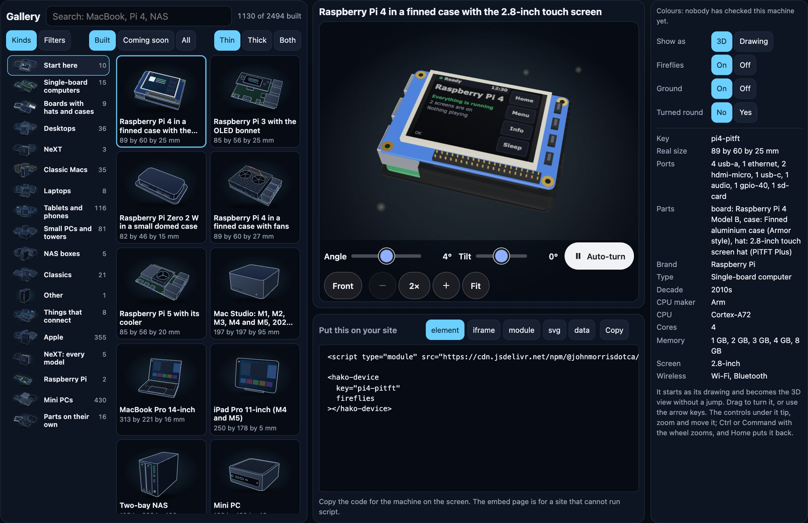
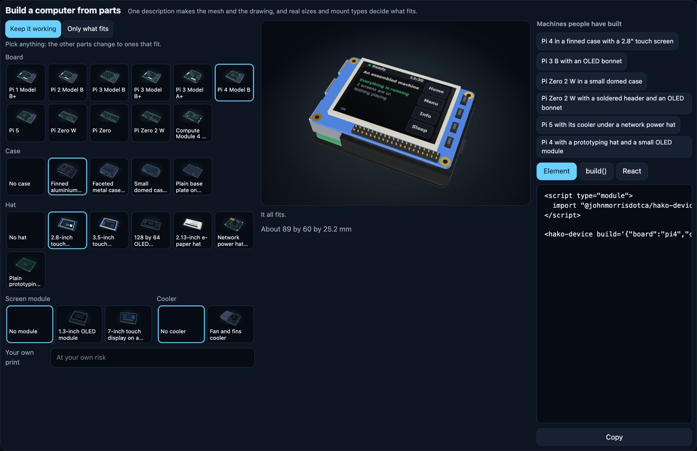

<h1 align="center">Hako Devices <sub>箱</sub></h1>

<p align="center"><strong>Line drawings and 3D views of computers, that you drop into a page and assemble from parts.</strong><br>
Boards, hats, cases, NAS boxes, desktops, laptops, tablets, game consoles, old phones and more: a <code>.svg</code> and a <code>.glb</code> for each, a web component that shows the drawing first and crossfades to 3D, and a typed model that checks whether a machine really goes together.</p>

<p align="center">
  <a href="https://github.com/johnmorrisdotca/hako-devices/actions/workflows/ci.yml"></a>
  <a href="https://www.npmjs.com/package/@johnmorrisdotca/hako-devices"></a>
  <a href="./LICENSE"></a>
  
</p>

<p align="center"><a href="https://johnmorrisdotca.github.io/hako-devices/"><strong>Open the demo →</strong></a> · <a href="./docs/parts.md">Build from parts</a> · <a href="./docs/element.md">The element</a> · <a href="./docs/scale.md">To scale</a> · <a href="./docs/styles.md">Styles</a></p>

<p align="center"></p>

<p align="center"></p>

## One minute

```sh
npm install @johnmorrisdotca/hako-devices three
```

```html
<script type="module">
  import "@johnmorrisdotca/hako-devices/element";
</script>

<hako-device key="pi4"></hako-device>
<hako-device build='{"board":"pi4","case":"armor","hat":"pitft-28"}'></hako-device>
```

That is all a page needs with a bundler. The drawing shows at once; when the element comes on screen and the browser can draw WebGL, the 3D view takes over without a jump. Drag to turn it, or use the arrow keys. With no WebGL, under Save-Data, or on any failure, the drawing stays.

Build one from a script, in Node or a browser:

```ts
import { build } from "@johnmorrisdotca/hako-devices/build";

const machine = build({ board: "pi4", case: "armor", hat: "pitft-28" });
machine.report.ok; // true
machine.glb().bytes; // a .glb file's bytes
machine.svg("thin"); // the drawing
```

Ask whether it fits without building, with no three.js at all:

```ts
import { check } from "@johnmorrisdotca/hako-devices";

const report = check({ board: "pi4", case: "argon", hat: "pitft-28" });
report.ok; // false
report.issues[0].message; // "Faceted metal case (Argon ONE style) closes over the header, so a hat cannot reach it."
```

## What is in it

| Entry | What | Needs |
| --- | --- | --- |
| `@johnmorrisdotca/hako-devices` | The catalogue (`DEVICES`, `catalogue()`, `statusOf`), the parts (`PARTS`), the fit check (`check`), the camera rule (`frameFor`), mapping helpers (`piKey`, `macKey`, `nasKey`, `pcKey`, `deviceKeyOf`), styles, scale helpers, screen pictures | Nothing |
| `.../tags` | `FACETS`, `tagsOf(key)`, `matchesPicks(key, picks)`, `facetCounts(keys, picks)`: filter machines by what they are. Its own entry because the table is large | Nothing |
| `.../build` | `build(description)`, `buildDevice(key)`, `buildPart(id)`: one mesh and one drawing. `toGlb`, `Drawing`, `Box` | `three` |
| `.../element` | `<hako-device>` and `<hako-lineup>`: load `three` only when a 3D view is wanted | `three` for 3D |
| `.../react` | A thin `<HakoDevice>` wrapper | `react` |
| `.../assets/*` | Ready files: `pi4.glb`, `pi4.svg`, `pi4.thick.svg`, `parts/armor.glb`, `coming-soon.svg` | Nothing |

## Build computers from parts

A description names a base and what goes on it. Parts attach by mount: a hat on a 40-pin header, a case around a board's sockets, a screen module on a hat's display header, a board on a display's back, a drive in a bay, a stand under a tablet. Each is checked by real millimetres and mount type, and one description makes the mesh and the drawing, so they never disagree.

```ts
import { build } from "@johnmorrisdotca/hako-devices/build";

build({ board: "pi3b", hat: "oled-bonnet" });
build({ board: "pi-zero-2w", case: "unipi" });
build({ board: "pi-zero-2w", solderHeader: true, hat: "oled-bonnet" });
build({ board: "pi5", cooler: "active-cooler", hat: "poe-plus" });
build({ base: "nas-4bay", drives: ["hdd-35", "hdd-35", null, null] });
build({ base: "ipad", stand: null });
```

[docs/parts.md](docs/parts.md) has every part and every rule.

## Styles

A drawing style is one small table of settings: line weight, colours, fills. `thin` is the default and `thick` the other, and every device and part is made in each, so another style is one entry. See [docs/styles.md](docs/styles.md).

```html
<hako-device key="pi4" drawing-style="thick"></hako-device>
```

`style="thick"` works too, but `style` is HTML's global attribute and a strict content security policy reports it, so `drawing-style` is the one to use.

## To scale

By default each drawing fills its own picture, so a small board looks as big as a tower. With `scale="real"` it has its true size, and `<hako-lineup>` stands machines side by side on one baseline. Lines keep the width their style sets at any size. See [docs/scale.md](docs/scale.md).

```html
<hako-device key="pi-zero" scale="real" unit="2px/mm"></hako-device>
<hako-lineup keys="pi-zero,pi5,nas-2bay" unit="1px/mm" ruler labels></hako-lineup>
```

## A live screen

Paint a device's screen with your own words or your own canvas. See [docs/element.md](docs/element.md).

```js
const device = document.querySelector("hako-device");
device.paintScreen({ title: "Kitchen", lines: ["3 screens are on"], status: "good" });
device.paintScreen((ctx, width, height) => ctx.fillRect(0, 0, width, height));
```

## React

React keeps `key` for itself, so the wrapper's prop is `device`:

```jsx
import { HakoDevice } from "@johnmorrisdotca/hako-devices/react";

<HakoDevice device="pi4" drawingStyle="thick" />;
<HakoDevice build={{ board: "pi4", case: "armor", hat: "pitft-28" }} />;
```

## No logos, and a word on trademarks

**No mesh or drawing carries a logo, a mark or brand printing.** There is a neutral `print` option, so you can paint your own words on a device at your own risk:

```html
<hako-device key="mac-studio" print="Studio One"></hako-device>
```

Product names appear only as plain descriptive words in the catalogue and the docs. All trademarks belong to their owners, and this project is not affiliated with, sponsored by or endorsed by any of them. The drawings and meshes are original work drawn from plain geometry and published sizes.

## Filter by what a machine is

Every machine on the list has a brand and a type, and most a decade. Where a source gives them, it also has its CPU and CPU maker, cores, memory, operating system, screen, ports, wireless, weight, generation and parts. A fact with no source is left out, never guessed, so a filter by CPU leaves out machines nobody has sourced yet.

```ts
import { catalogue } from "@johnmorrisdotca/hako-devices";
import { matchesPicks } from "@johnmorrisdotca/hako-devices/tags";

const intelLaptops = catalogue().filter(({ key }) => matchesPicks(key, { type: ["Laptop"], cpuMaker: ["Intel"] }));
```

## Groups and colours

`groupLayout` and `groupSample` lay out a group's picture, a few of its machines in a bunch. `FINISHES` lists a machine's other colours, each a device of its own. See [docs/assets.md](docs/assets.md).

## Coming soon

The catalogue also lists machines with no mesh yet (`status: "planned"`). They have a name and no shape: the gallery and `<hako-device key="...">` show the one "Coming soon" picture for each, and `catalogue()`, `statusOf(key)` and `catalogueCounts()` say which is which. [docs/wishlist.md](docs/wishlist.md) is the list.

## Help fill it in

**This list has gaps, and you can help close them.** Thousands of machines are listed, and many are missing a size, a CPU, a year or a date. Most are still waiting for a drawing, and some drawings are missing details a real owner would spot at once. If you know a machine, or have one on your desk, you can make this better:

- **Add a fact you can source:** a size, a CPU, a release or end-of-support date, or where a button or camera really sits.
- **Correct something wrong:** a wrong fact matters more than a missing one, so these come first.
- **Add a machine that is missing,** or a whole product line nobody has listed yet.
- **Look at a drawing beside the real thing** and tell us what is off.

A blank is always fine. A guess never is: every fact names the page it came from, so please link yours. [Open an issue](https://github.com/johnmorrisdotca/hako-devices/issues) with the machine, the fact and the link, or send a pull request following [CONTRIBUTING.md](CONTRIBUTING.md#add-or-correct-a-fact).

## The rest

[CONTRIBUTING.md](CONTRIBUTING.md) · [SECURITY.md](SECURITY.md) · [CHANGELOG.md](CHANGELOG.md) · [NOTICE.md](NOTICE.md) · MIT licence
