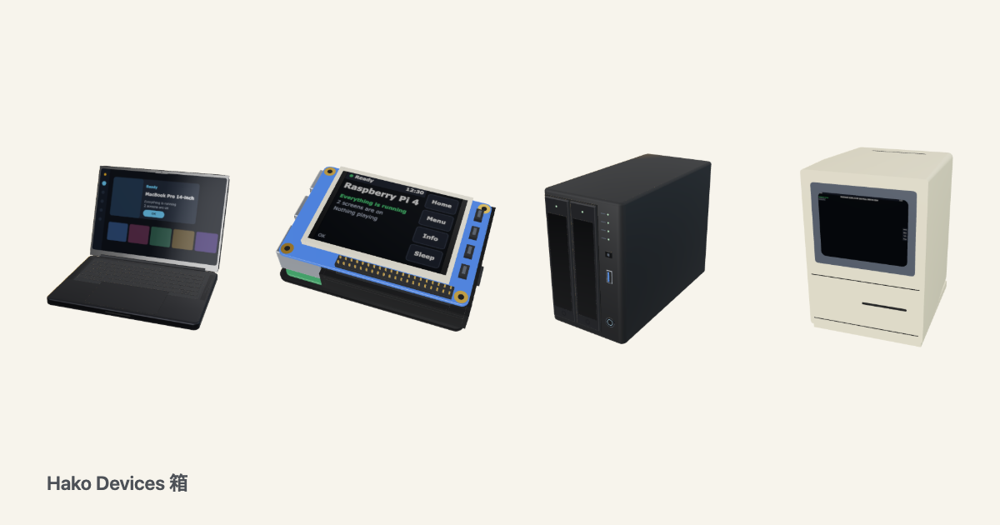

<p align="center"><a href="https://johnmorrisdotca.github.io/hako-devices/"><picture><source media="(prefers-color-scheme: dark)" srcset="https://raw.githubusercontent.com/johnmorrisdotca/hako-devices/main/docs/images/thumbnail-dark.png"></picture></a></p>

<h1 align="center">Hako Devices <sub>箱</sub></h1>

<p align="center"><strong>Line drawings and 3D views of computers, that you drop into a page and assemble from parts.</strong><br>
Boards, hats, cases, NAS boxes, desktops, laptops, tablets, game consoles, old phones and more: a <code>.svg</code> and a <code>.glb</code> for each, a web component that shows the drawing first and crossfades to 3D, and a typed model that checks whether a machine really goes together.</p>

<p align="center">
  <a href="https://github.com/johnmorrisdotca/hako-devices/actions/workflows/ci.yml"></a>
  <a href="https://www.npmjs.com/package/@johnmorrisdotca/hako-devices"></a>
  <a href="./LICENSE"></a>
  
</p>

<p align="center"><a href="https://johnmorrisdotca.github.io/hako-devices/"><strong>Open the demo →</strong></a> · <a href="./docs/parts.md">Build from parts</a> · <a href="./docs/element.md">The element</a> · <a href="./docs/embed.md">Use one on your site</a> · <a href="./docs/scale.md">To scale</a> · <a href="./docs/styles.md">Styles</a></p>

<p align="center"></p>

<p align="center"></p>

## One minute

```sh
npm install @johnmorrisdotca/hako-devices three
```

```html
<script type="module">
  import "@johnmorrisdotca/hako-devices/element";
</script>

<hako-device key="pi4"></hako-device>
<hako-device build='{"board":"pi4","case":"armor","hat":"pitft-28"}'></hako-device>
```

That is all a page needs with a bundler. The drawing shows at once; when the element comes on screen and the browser can draw WebGL, the 3D view takes over without a jump. Drag to turn it, or use the arrow keys; [the family's view controls](docs/element.md#the-familys-view-controls) add tilt, zoom and move. With no WebGL, under Save-Data, or on any failure, the drawing stays.

## Put one on your own site

These drawings are yours to use on a page of your own. The demo copies the code for the machine on the screen: the element, an iframe of the embed page when a site cannot run script, a module, the SVG, and a data address for an image. [docs/embed.md](docs/embed.md) has each one.

`embedCode` lives on `@johnmorrisdotca/hako-devices/embed`, because the SVG is made with three.js. Reading the attributes does not need it.

```ts
import { attributesFromOptions, deviceFromParams, deviceToParams, embedCode } from "@johnmorrisdotca/hako-devices/embed";

const options = { key: "pi4", drawingStyle: "thick", fireflies: true };
const attributes = attributesFromOptions(options);
attributes.key; // "pi4"
attributes.fireflies; // ""
deviceFromParams(deviceToParams(options)).drawingStyle; // "thick"
embedCode(options, "iframe").includes("embed.html"); // true
embedCode(options, "element").includes("fireflies"); // true
```

Build one from a script, in Node or a browser:

```ts
import { build } from "@johnmorrisdotca/hako-devices/build";

const machine = build({ board: "pi4", case: "armor", hat: "pitft-28" });
machine.report.ok; // true
machine.glb().bytes; // a .glb file's bytes
machine.svg("thin"); // the drawing
```

Ask whether it fits without building, with no three.js at all:

```ts
import { check } from "@johnmorrisdotca/hako-devices";

const report = check({ board: "pi4", case: "argon", hat: "pitft-28" });
report.ok; // false
report.issues[0].message; // "Faceted metal case (Argon ONE style) closes over the header, so a hat cannot reach it."
```

## What is in it

| Entry | What | Needs |
| --- | --- | --- |
| `@johnmorrisdotca/hako-devices` | The catalogue (`DEVICES`, `catalogue()`, `statusOf`), the parts (`PARTS`), the fit check (`check`), what fits a set of choices and the nearest set that works (`whatFits`, `nearestWorking`, `fillNeeded`), the camera rule (`frameFor`), `findMachine(keyOrAlias)`, mapping helpers (`piKey`, `macKey`, `nasKey`, `pcKey`, `deviceKeyOf`), styles, scale helpers, screen pictures | Nothing |
| `.../tags` | `FACETS`, `tagsOf(key)`, `matchesPicks(key, picks)`, `facetCounts(keys, picks)`, `yearOf(key)`, `inYears(key, { from, to })`, `yearSpan(keys)`: filter machines by what they are (brand, type, decade, discontinued year, CPU, memory, operating system, wireless, weight, colour...). Its own entry because the table is large | Nothing |
| `.../build` | `build(description)`, `buildDevice(key)`, `buildPart(id)`: one mesh and one drawing. `toGlb`, `Drawing`, `Box` | `three` |
| `.../element` | `<hako-device>` and `<hako-lineup>`: load `three` only when a 3D view is wanted | `three` for 3D |
| `.../embed` | `embedCode`: the element, an iframe, a module, the SVG or a data address | `three` for the SVG |
| `.../react` | A thin `<HakoDevice>` wrapper | `react` |
| `.../machines.json` | The machine list as static JSON: key, name, maker, family, year, status, tags and, for drawn devices, size and ports | Nothing |
| `.../assets/*` | Ready files: `pi4.glb`, `pi4.svg`, `pi4.thick.svg`, `parts/armor.glb`, `coming-soon.svg` | Nothing |

## Build computers from parts

A description names a base and what goes on it. Parts attach by mount: a hat on a 40-pin header, a case around a board's sockets, a screen module on a hat's display header, a board on a display's back, a drive in a bay, a stand under a tablet. Each is checked by real millimetres and mount type, and one description makes the mesh and the drawing, so they never disagree.

```ts
import { build } from "@johnmorrisdotca/hako-devices/build";

build({ board: "pi3b", hat: "oled-bonnet" });
build({ board: "pi-zero-2w", case: "unipi" });
build({ board: "pi-zero-2w", solderHeader: true, hat: "oled-bonnet" });
build({ board: "pi5", cooler: "active-cooler", hat: "poe-plus" });
build({ base: "nas-4bay", drives: ["hdd-35", "hdd-35", null, null] });
build({ base: "ipad", stand: null });
```

[docs/parts.md](docs/parts.md) has every part and every rule.

## Styles

A drawing style is one small table of settings: line weight, colours, fills. `thin` is the default and `thick` the other, and every device and part is made in each, so another style is one entry. See [docs/styles.md](docs/styles.md).

```html
<hako-device key="pi4" drawing-style="thick"></hako-device>
```

`style="thick"` works too, but `style` is HTML's global attribute and a strict content security policy reports it, so `drawing-style` is the one to use.

## To scale

By default each drawing fills its own picture, so a small board looks as big as a tower. With `scale="real"` it has its true size, and `<hako-lineup>` stands machines side by side on one baseline. Lines keep the width their style sets at any size. See [docs/scale.md](docs/scale.md).

```html
<hako-device key="pi-zero" scale="real" unit="2px/mm"></hako-device>
<hako-lineup keys="pi-zero,pi5,nas-2bay" unit="1px/mm" ruler labels></hako-lineup>
```

## A live screen

Paint a device's screen with your own words or your own canvas. See [docs/element.md](docs/element.md).

```js
const device = document.querySelector("hako-device");
device.paintScreen({ title: "Kitchen", lines: ["3 screens are on"], status: "good" });
device.paintScreen((ctx, width, height) => ctx.fillRect(0, 0, width, height));
```

## React

React keeps `key` for itself, so the wrapper's prop is `device`:

```jsx
import { HakoDevice } from "@johnmorrisdotca/hako-devices/react";

<HakoDevice device="pi4" drawingStyle="thick" />;
<HakoDevice build={{ board: "pi4", case: "armor", hat: "pitft-28" }} />;
```

## No logos, and a word on trademarks

**No mesh or drawing carries a logo, a mark or brand printing.** There is a neutral `print` option, so you can paint your own words on a device at your own risk:

```html
<hako-device key="mac-studio" print="Studio One"></hako-device>
```

Product names appear only as plain descriptive words in the catalogue and the docs. All trademarks belong to their owners, and this project is not affiliated with, sponsored by or endorsed by any of them. The drawings and meshes are original work drawn from plain geometry and published sizes.

## Filter by what a machine is

Every machine on the list has a brand and a type, and most a decade. Where a page gives them, it also has the year it was discontinued, its CPU and CPU maker, cores, memory, operating system, screen, ports, wireless (Wi-Fi, Bluetooth, cellular), weight, colour, generation and parts. Every tag names the page it came from, and a test fails on one that does not. A fact with no source is left out, never guessed, so a filter by operating system or colour leaves out machines nobody has sourced yet, and a page about a family is never applied to its models. [docs/machines.md](docs/machines.md#tags) has the kinds and the rules.

```ts
import { catalogue } from "@johnmorrisdotca/hako-devices";
import { matchesPicks } from "@johnmorrisdotca/hako-devices/tags";

const intelLaptops = catalogue().filter(({ key }) => matchesPicks(key, { type: ["Laptop"], cpuMaker: ["Intel"] }));
const wifiMacsOfThe2000s = catalogue().filter(({ key }) => matchesPicks(key, { maker: ["Apple"], decade: ["2000s"], wireless: ["Wi-Fi"], os: ["Mac OS X"] }));
```

To filter by date, `yearOf(key)` gives the year a machine came out, or `null` where no sure year is known, and `inYears(key, { from, to })` keeps a span, both ends included. With a limit set, a machine of unknown year is left out. `yearSpan(keys)` gives the first and last year of a list.

```ts
import { catalogue } from "@johnmorrisdotca/hako-devices";
import { inYears } from "@johnmorrisdotca/hako-devices/tags";

const upTo2010 = catalogue().filter(({ key }) => inYears(key, { to: 2010 }));
```

## Find a machine by a nickname

Every machine has a key and can have aliases: other names it goes by. `findMachine` takes either.

```ts
import { findMachine } from "@johnmorrisdotca/hako-devices";

findMachine("trash-can")?.key; // "mac-pro-late-2013"
findMachine("raspberry-pi-zero")?.key; // "rpi-zero"
```

[docs/machines.md](docs/machines.md#aliases) has the rules. The aliases are in the machine list as JSON, below, and the demo's search matches them.

## The machine list as JSON

Every machine is also one static file, for a page or a script that wants the list and no code: `@johnmorrisdotca/hako-devices/machines.json`, and https://johnmorrisdotca.github.io/hako-devices/machines.json on the demo site (it allows other sites to read it). Each machine has its `key`, `name`, `aliases`, `maker`, `family`, `status`, `mesh`, `tags` and, for a drawn device, `size` in millimetres and `ports`. [docs/machines.md](docs/machines.md) has every field, and what is left out and why.

**When machines are added, the list is regenerated and published with them.** Run `pnpm wishlist` and then `pnpm machines`, and commit `data/machines.json` with the machine. `pnpm check` fails when the file is out of date, so a machine cannot go in without it; the build ships the file in the package and every push to `main` puts it on the demo site.

## Groups and colours

`groupLayout` and `groupSample` lay out a group's picture, a few of its machines in a bunch. `FINISHES` lists a machine's other colours that have a drawing, each a device of its own. See [docs/assets.md](docs/assets.md).

**What colours a machine came in** is in its own entry point, because the table is large: `coloursOf(key)` from `@johnmorrisdotca/hako-devices/colours` gives each colour's name in the maker's word, the pages that say so, a swatch that says how it is known, and the key of its drawing, or null when it has none. An empty list means nobody has checked that machine yet, not that it has no colours; a colour with no drawing is still listed. `<hako-device body-colour="#e8a0b4">` shows the colour on the body of the mesh, in the 3D view.

```ts
import { coloursOf, colouredKeys } from "@johnmorrisdotca/hako-devices/colours";

coloursOf("imac-1998")[0].name; // "Bondi Blue"
coloursOf("macbook-air-m2-2022").length; // 4
coloursOf("macbook-air-m2-2022").find(({ name }) => name === "Silver")?.drawing; // "macbook-air-13-silver"
coloursOf("macbook-air-m2-2022").find(({ name }) => name === "Starlight")?.drawing; // null
coloursOf("a-machine-nobody-has").length; // 0
colouredKeys().length > 300; // true
```

## Coming soon

The catalogue also lists machines with no mesh yet (`status: "planned"`). They have a name and no shape: the gallery and `<hako-device key="...">` show the one "Coming soon" picture for each, and `catalogue()`, `statusOf(key)` and `catalogueCounts()` say which is which. [docs/wishlist.md](docs/wishlist.md) is the list.

## Help fill it in

**This list has gaps, and you can help close them.** Thousands of machines are listed, and many are missing a size, a CPU, a year or a date. Most are still waiting for a drawing, and some drawings are missing details a real owner would spot at once. If you know a machine, or have one on your desk, you can make this better:

- **Add a fact you can source:** a size, a CPU, a release or end-of-support date, or where a button or camera really sits.
- **Correct something wrong:** a wrong fact matters more than a missing one, so these come first.
- **Add a machine that is missing,** or a whole product line nobody has listed yet.
- **Look at a drawing beside the real thing** and tell us what is off.

A blank is always fine. A guess never is: every fact names the page it came from, so please link yours. [Open an issue](https://github.com/johnmorrisdotca/hako-devices/issues) with the machine, the fact and the link, or send a pull request following [CONTRIBUTING.md](CONTRIBUTING.md#add-or-correct-a-fact).

**Want to draw machines?** [Building machines](docs/building-machines.md) has the steps, the mistakes to avoid and ready prompts for directing a coding agent to the same standard.

## The name

Hako is the Japanese word 箱 for a box.

## The family

<!-- family:start (made by scripts/family-readme.mjs from scripts/family-template.mjs; change those, not this) -->
Hako Devices is one of forty-one packages, each made for the same site, each at
[github.com/johnmorrisdotca](https://github.com/johnmorrisdotca) or [github.com/spxis](https://github.com/spxis). The code of every one is MIT.

**Games — board**

- [Domino](https://github.com/johnmorrisdotca/domino) (ドミノ): dominoes and Mexican Train. [Demo](https://johnmorrisdotca.github.io/domino/).
- [Gunjin](https://github.com/johnmorrisdotca/gunjin) (軍人): five hidden-rank strategy games with pass-the-device play. [Demo](https://johnmorrisdotca.github.io/gunjin/).
- [Narabe](https://github.com/johnmorrisdotca/narabe) (並べ): one rules engine for abstract board games, from gomoku and Reversi to Go and checkers. [Demo](https://johnmorrisdotca.github.io/narabe/).
- [Sugoroku](https://github.com/johnmorrisdotca/sugoroku) (双六): backgammon and its variants, with the doubling cube and match play. [Demo](https://johnmorrisdotca.github.io/sugoroku/).
- [Tenka](https://github.com/johnmorrisdotca/tenka) (天下): world conquest for two to six, on a map of the real world. [Demo](https://johnmorrisdotca.github.io/tenka/).

**Games — cards & tiles**

- [Fuda Cards](https://github.com/johnmorrisdotca/fuda-cards) (札): collectible card frames with a true thickness, foil, stacks, wear and a binder, as two web components. [Demo](https://johnmorrisdotca.github.io/fuda-cards/).
- [Hitotsu](https://github.com/johnmorrisdotca/hitotsu) (一つ): a colour-card shedding game for two to eight, with the house rules people play. [Demo](https://johnmorrisdotca.github.io/hitotsu/).
- [Jarajara](https://github.com/johnmorrisdotca/jarajara) (ジャラジャラ): mahjong tiles drawn as SVG, stacked layouts, and the matching solitaire Awase. [Demo](https://johnmorrisdotca.github.io/jarajara/).
- [Kumimoji](https://github.com/johnmorrisdotca/kumimoji) (組み文字): a crossword tile race, in English and Japanese kana. [Demo](https://johnmorrisdotca.github.io/kumimoji/).
- [Toranpu](https://github.com/johnmorrisdotca/toranpu) (トランプ): a deck of playing cards, card games with computer players, and solitaires. [Demo](https://johnmorrisdotca.github.io/toranpu/).

**Games — puzzles**

- [Houseki](https://github.com/johnmorrisdotca/houseki) (宝石): gem and stone matching puzzles: falling triplets, stone collapse, colour chains and gem swap. [Demo](https://johnmorrisdotca.github.io/houseki/).
- [Jirai](https://github.com/johnmorrisdotca/jirai) (地雷): minesweeper on shaped grids with verified no-guess boards. [Demo](https://johnmorrisdotca.github.io/jirai/).
- [Karakuri](https://github.com/johnmorrisdotca/karakuri) (からくり): eight hyper-casual puzzle games, some of them physics: draw a shield, pull pins, cut ropes, slide blocks, pour tubes. [Demo](https://johnmorrisdotca.github.io/karakuri/).
- [Kazu](https://github.com/johnmorrisdotca/kazu) (数): grid number puzzles: Sudoku and its variants, Futoshiki and Skyscrapers. [Demo](https://johnmorrisdotca.github.io/kazu/).
- [Kyuubu](https://github.com/johnmorrisdotca/kyuubu) (キューブ): a turning cube for the browser, 2×2 to 7×7, with record solves to replay. [Demo](https://johnmorrisdotca.github.io/kyuubu/).
- [Meikyuu](https://github.com/johnmorrisdotca/meikyuu) (迷宮): mazes on squares, hexagons, triangles and circles, made from a seed and drawn through with a finger or the mouse. [Demo](https://johnmorrisdotca.github.io/meikyuu/).
- [Suido](https://github.com/johnmorrisdotca/suido) (水道): a pipe puzzle: turn the pieces until the water reaches every drain. [Demo](https://johnmorrisdotca.github.io/suido/).
- [Tobiishi](https://github.com/johnmorrisdotca/tobiishi) (飛び石): peg solitaire with nine boards and seeded solvable challenges. [Demo](https://johnmorrisdotca.github.io/tobiishi/).
- [Tsunagi](https://github.com/johnmorrisdotca/tsunagi) (繋ぎ): a line-joining logic puzzle whose every level has exactly one answer. [Demo](https://johnmorrisdotca.github.io/tsunagi/).

**Games — dice & random**

- [Korokoro](https://github.com/johnmorrisdotca/korokoro) (コロコロ): dice, with notation, exact odds, real sounds and the dice of many games. [Demo](https://johnmorrisdotca.github.io/korokoro/).
- [Tane](https://github.com/johnmorrisdotca/tane) (種): seeded random numbers and daily seeds, the same in every browser and on every server. [Demo](https://johnmorrisdotca.github.io/tane/).

**Language**

- [Bushu](https://github.com/johnmorrisdotca/bushu) (部首): find a kanji by the parts it is made of. [Demo](https://johnmorrisdotca.github.io/bushu/).
- [Hikidashi](https://github.com/johnmorrisdotca/hikidashi) (引き出し): a drawer of small Japanese text tools: era dates, kanji numerals, readings and sentence difficulty. [Demo](https://johnmorrisdotca.github.io/hikidashi/).
- [Jisho](https://github.com/johnmorrisdotca/jisho) (辞書): words of Japanese looked up by reading or written form, and the grades, JLPT levels, readings and look-alike pairs of 2,999 kanji. [Demo](https://johnmorrisdotca.github.io/jisho/).
- [Kotoba](https://github.com/johnmorrisdotca/kotoba) (言葉): word lists and word-game rules in English, French, German and Japanese. [Demo](https://johnmorrisdotca.github.io/kotoba/).

**Space Program X**

- [Chikyu Earth](https://github.com/johnmorrisdotca/chikyu-earth) (地球): a line-drawn globe that turns at the Earth's own rate, with an optional realistic Earth from space and markers for any place. [Demo](https://johnmorrisdotca.github.io/chikyu-earth/).
- [Hoshi Stars](https://github.com/johnmorrisdotca/hoshi-stars) (星): the stars you can see without a telescope, with names, colours and distances, the constellations with their lines and boundaries, and the Messier objects, drawn on any of seven sky maps. [Demo](https://johnmorrisdotca.github.io/hoshi-stars/).
- [Uchusen Rockets](https://github.com/johnmorrisdotca/uchusen-rockets) (宇宙船): rockets drawn from sourced sizes, as line drawings and 3D views you can take apart and turn, with a check that a rocket really goes together. [Demo](https://johnmorrisdotca.github.io/uchusen-rockets/).
- [Wakusei Planets](https://github.com/johnmorrisdotca/wakusei-planets) (惑星): the Sun, the planets and their moons, as line drawings, shaded drawings and painted surface maps, with their real sizes, tilt and rotation. [Demo](https://johnmorrisdotca.github.io/wakusei-planets/).

**Geography & data**

- [address-plus](https://github.com/johnmorrisdotca/address-plus) (アドレスプラス): parse and format addresses in the United States, Canada, Japan, Australia, France, Germany and the United Kingdom. [Demo](https://johnmorrisdotca.github.io/address-plus/).
- [Chizu](https://github.com/johnmorrisdotca/chizu) (地図): maps of the world and of countries' regions, in English and Japanese, with a quiz and callouts. [Demo](https://johnmorrisdotca.github.io/chizu/).
- [Hako Devices](https://github.com/johnmorrisdotca/hako-devices) (箱): line drawings and 3D views of computers, phones, consoles and NAS boxes, from published sizes. [Demo](https://johnmorrisdotca.github.io/hako-devices/).
- [Hata](https://github.com/johnmorrisdotca/hata) (旗): country and regional flags as SVG, at their true proportions and keyed by ISO code. [Demo](https://johnmorrisdotca.github.io/hata/).
- [Koyomi Calendars](https://github.com/johnmorrisdotca/koyomi-calendars) (暦): calendar-page icons and whole months as SVG, in light and dark, with page-turning from one day to the next. [Demo](https://johnmorrisdotca.github.io/koyomi-calendars/).
- [Kuni](https://github.com/johnmorrisdotca/kuni) (国): countries and their regions, with ISO codes and names in English and Japanese. [Demo](https://johnmorrisdotca.github.io/kuni/).

**Sports**

- [Dougu Sports](https://github.com/johnmorrisdotca/dougu-sports) (道具): sports emblems as SVG: trophies, medals, crests, and the ball and gear of every sport, with optional 3D turning. [Demo](https://johnmorrisdotca.github.io/dougu-sports/).
- [Kyogijo Stadiums](https://github.com/johnmorrisdotca/kyogijo-stadiums) (競技場): sports fields, rinks, courts and ballparks drawn to scale as SVG, with each team and the score on them. [Demo](https://johnmorrisdotca.github.io/kyogijo-stadiums/).
- [Meigen Sports](https://github.com/johnmorrisdotca/meigen-sports) (名言): sports quotations and on-this-day history. [Demo](https://johnmorrisdotca.github.io/meigen-sports/).
- [Senshu Jerseys](https://github.com/johnmorrisdotca/senshu-jerseys) (選手): sports jerseys, sweaters, kits, caps, helmets and retired-number banners as SVG, front and back, with optional 2.5D turning. [Demo](https://johnmorrisdotca.github.io/senshu-jerseys/).
- [Taisen Brackets](https://github.com/johnmorrisdotca/taisen-brackets) (対戦): a sport-agnostic tournament bracket, drawn as SVG, from a list of ties. [Demo](https://johnmorrisdotca.github.io/taisen-brackets/).

**Developer tools**

- [REST in Pieces](https://github.com/spxis/rest-in-pieces) (レスト・イン・ピーシーズ): seeded test data and REST APIs for frontend development, with latency and error drills. [Demo](https://spxis.github.io/rest-in-pieces/).


**This package is Hako Devices.** The demos of all forty-one share one header and footer, so each links the rest.
<!-- family:end -->

## The rest

[CONTRIBUTING.md](CONTRIBUTING.md) · [SECURITY.md](SECURITY.md) · [CHANGELOG.md](CHANGELOG.md) · [NOTICE.md](NOTICE.md) · MIT licence
